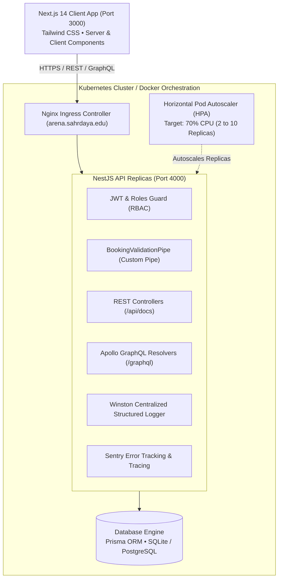
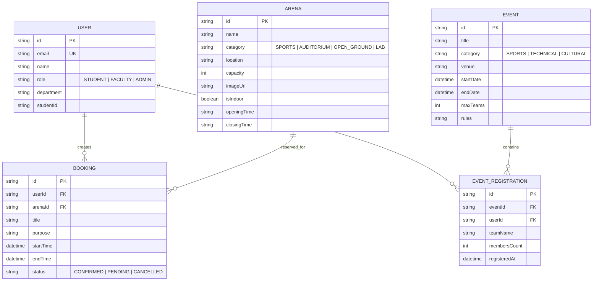

# 🏟️ CAMPUS ARENA
### Modern Campus Sports, Facility & Cultural Arena Management Platform
> **Course**: Web Technologies (CSE)  
> **Institution**: Sahrdaya College of Engineering and Technology (Autonomous)  
> **Department**: Department of Computer Science & Engineering  
> **Architecture**: Next.js 14 (App Router) + NestJS + GraphQL (Apollo) + Prisma ORM + Docker & Kubernetes + Sentry & Winston

---

## 📖 Executive Summary & What This Project Does

**Campus Arena** is an enterprise-grade web application built to digitize and automate facility bookings and tournament management across college campuses:
- **Facility & Court Reservations**: Real-time reservation for badminton courts, FIFA-standard football turf, cricket nets, robotics lab, and auditoriums with **instant slot conflict detection**.
- **Digital Arena Passes**: Generates verified entry badges with unique pass IDs for students and faculty.
- **Tournaments & Campus Fests**: Team registration for inter-department leagues, hackathons, and cultural meets with automatic capacity caps.
- **Live Leaderboard & Standings**: Real-time points tally, medal tracking (Gold, Silver, Bronze), and live match score tracking for the annual Rolling Trophy.
- **Role-Based Access Control (RBAC)**: Fine-grained permissions for Students, Faculty Coordinators, and Facility Administrators.

---

## 🎯 Syllabus Module-to-Code Mapping

Every single unit of your **Web Technologies** curriculum is implemented directly in the codebase:

```
┌────────────────────────────────────────────────────────────────────────┐
│                        WEB TECHNOLOGIES SYLLABUS                       │
├────────────────────────────────────────────────────────────────────────┤
│ Module I: Modern Frontend Development                                  │
│  ├── 1.1 Modern Frontend Architecture  ──> Next.js 14 App Router       │
│  ├── 1.2 Next.js Pages, Routing, SSR   ──> frontend/app/arenas, events │
│  ├── 1.3 CSS & Asset Optimization      ──> next/image, next/font Inter │
│  ├── 1.4 Metadata Management           ──> generateMetadata & OG tags  │
│  └── 1.5 Tailwind CSS                  ──> Responsive Dark Glassmorphism│
├────────────────────────────────────────────────────────────────────────┤
│ Module II: Backend Development with NestJS                             │
│  ├── 2.1 & 2.2 Modules, Controllers    ──> backend/src/arenas, bookings│
│  ├── 2.3 Dependency Injection (DI)     ──> PrismaService, Providers    │
│  ├── 2.4 Built-in vs. Custom Pipes     ──> BookingValidationPipe       │
│  └── 2.5 Security: Auth & JWT RBAC     ──> JwtAuthGuard, RolesGuard    │
├────────────────────────────────────────────────────────────────────────┤
│ Module III: APIs and Cloud Integration                                 │
│  ├── 3.1 REST vs GraphQL Overview      ──> Dual REST + GraphQL APIs    │
│  ├── 3.2 Cloud Database Integration    ──> Prisma ORM + Relational DB  │
│  ├── 3.3 GraphQL Schema & Resolvers    ──> @nestjs/graphql & Apollo    │
│  ├── 3.4 Object Types & Input Types    ──> ArenaModel, CreateBookingDto│
│  └── 3.5 GraphQL Queries & Mutations   ──> arenas, createBooking, etc. │
├────────────────────────────────────────────────────────────────────────┤
│ Module IV: DevOps, CI/CD and Observability                             │
│  ├── 4.1 Monitoring, Metrics, Tracing  ──> /health and /metrics APM    │
│  ├── 4.2 Monitoring Tools & APM        ──> Prometheus exposition format│
│  ├── 4.3 Kubernetes & Automated Scaling──> k8s/ manifests + HPA        │
│  ├── 4.4 CI/CD & Error Tracking Sentry ──> .github/workflows + Sentry  │
│  └── 4.5 Centralized Log Management    ──> Winston JSON Logger         │
└────────────────────────────────────────────────────────────────────────┘
```

---

## 🏛️ System Architecture



---

## 🗄️ Relational Database Schema (ER Diagram)



---

## 🔑 Default Credentials for Evaluation

The database is pre-seeded with three distinct accounts demonstrating Role-Based Access Control (RBAC):

| Role | Email | Password | Allowed Capabilities |
| :--- | :--- | :--- | :--- |
| **Student** | `student@campusarena.edu` | `student123` | Book arenas, view passes, cancel own bookings, register tournament teams |
| **Faculty Coordinator** | `coordinator.cse@campusarena.edu` | `faculty123` | Create tournaments/fests, approve arena slots, cancel student bookings |
| **Facility Admin** | `admin@campusarena.edu` | `admin123` | Create new arenas, delete facilities, view all logs, access telemetry |

---

## 🚀 Step-by-Step Quickstart Guide

### 1. Prerequisites
- **Node.js**: v18+ or v20+ (Node v22 detected and verified)
- **Git**
- Optional: **Docker** & **Docker Compose**

### 2. Setup the NestJS Backend
Open a terminal in the project directory:

```bash
cd backend
npm install
npx prisma generate
npm run prisma:push
npm run prisma:seed
npm run start:dev
```
Backend will start at:
- **API Endpoint**: `http://localhost:4000`
- **Swagger REST Docs**: `http://localhost:4000/api/docs`
- **Apollo GraphQL Playground**: `http://localhost:4000/graphql`
- **Health & Telemetry Metrics**: `http://localhost:4000/health`

### 3. Setup the Next.js Frontend
Open a second terminal:

```bash
cd frontend
npm install
npm run dev
```
Frontend will be live at:
- **Web App**: `http://localhost:3000`

---

## 🐳 Docker & Kubernetes Deployment (Module IV)

### Running with Docker Compose:
```bash
docker-compose up --build
```

### Deploying to Kubernetes:
```bash
kubectl apply -f k8s/namespace.yaml
kubectl apply -f k8s/backend-deployment.yaml
kubectl apply -f k8s/frontend-deployment.yaml
kubectl apply -f k8s/hpa.yaml
kubectl apply -f k8s/ingress.yaml
```

---

## 🧪 Testing & Demonstration for Lab Viva

### 1. Test Custom Request Validation Pipe (Module II.4)
Try submitting a booking where `endTime` is before `startTime` or duration exceeds 4 hours.
`BookingValidationPipe` catches the bad request before it touches the database and outputs:
```json
{
  "statusCode": 400,
  "error": { "message": "Booking slot startTime must be before endTime" }
}
```

### 2. Test Conflict Detection (Double-Booking Prevention)
Attempt to reserve a time slot that overlaps with an existing booking. The service throws an HTTP 409 Conflict:
```json
{
  "statusCode": 409,
  "error": { "message": "Slot collision: Arena is already reserved during this window." }
}
```

### 3. Test GraphQL Resolvers (Module III.3 & III.5)
Visit `http://localhost:4000/graphql` and run:
```graphql
query GetCampusArenas {
  arenas {
    id
    name
    category
    location
    capacity
  }
}
```

### 4. Test Sentry & Health Observability (Module IV.1 & IV.4)
Visit `http://localhost:4000/health` or `/metrics` to view uptime, Node.js memory heap usage, database latency, and APM Prometheus metrics.
