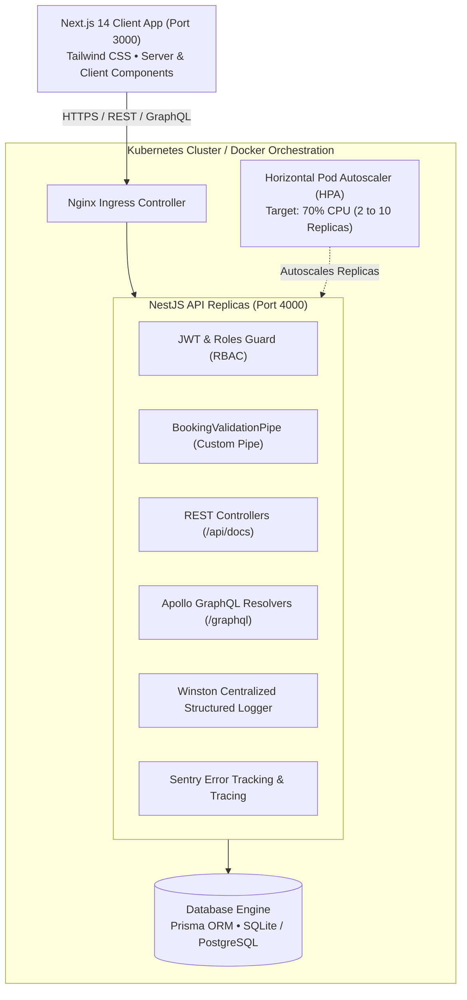
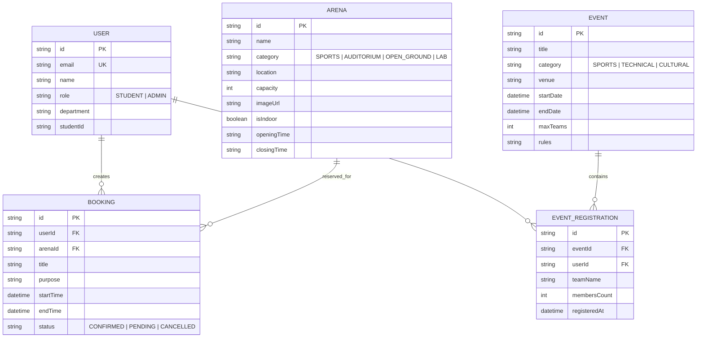

# 🏟️ CAMPUS ARENA
### Modern Campus Sports, Facility & Cultural Arena Management Platform
> **Institution**: Sahrdaya College of Engineering and Technology (Autonomous)  
> **Architecture**: Next.js 14 (App Router) + NestJS + GraphQL (Apollo) + Prisma ORM + Docker & Kubernetes + Sentry & Winston

---

## 📖 Executive Summary

**Campus Arena** is an enterprise-grade digital platform engineered to unify and streamline campus facility bookings, sports tournaments, hackathons, and cultural fests:
- **Facility & Court Reservations**: Real-time reservation for badminton courts, FIFA-standard football turf, cricket nets, robotics lab, and auditoriums with **instant slot conflict detection**.
- **1-Click Tournament Enrollment**: Fast enrollment with student department selection (CSE, ECE, BME, MECH, etc.).
- **Live Department Leaderboard**: Real-time points tally, medal tracking (Gold, Silver, Bronze), and live match scores for the Annual Campus Rolling Trophy.
- **Admin Tournament Control Center**: Centralized administrative tools to create, edit, close tournaments, and award points to departments.
- **Role-Based Access Control (RBAC)**: Secure access separation for Students and Administrators via JWT tokens.

---

## 🏛️ System Architecture



---

## 🗄️ Relational Database Schema (ER Diagram)



---

## 🔑 Default Accounts

The database comes pre-configured with accounts for demonstration:

| Role | Email | Password | Capabilities |
| :--- | :--- | :--- | :--- |
| **Student** | `student@campusarena.edu` | `student123` | Book arenas, enroll in tournaments, select department, view passes |
| **Admin** | `admin@campusarena.edu` | `admin123` | Add/delete tournaments, award department points, monitor telemetry |

---

## 🚀 Setup & Execution Guide

### 1. Prerequisites
- **Node.js**: v18+ or v20+
- **Git**
- Optional: **Docker** & **Docker Compose**

### 2. Run the Backend API
```bash
cd backend
npm install
npx prisma generate
npm run prisma:push
npm run prisma:seed
npm run start:dev
```
Backend services:
- **API Server**: `http://localhost:4000`
- **Swagger Documentation**: `http://localhost:4000/api/docs`
- **GraphQL Apollo Playground**: `http://localhost:4000/graphql`
- **Health Telemetry**: `http://localhost:4000/health`

### 3. Run the Frontend Web Portal
```bash
cd frontend
npm install
npm run dev
```
Open **`http://localhost:3000`** in your browser.

---

## 🐳 Docker & Kubernetes Deployment

### Multi-Container Docker Compose
```bash
docker-compose up --build
```

### Kubernetes Cluster Deployment
```bash
kubectl apply -f k8s/namespace.yaml
kubectl apply -f k8s/backend-deployment.yaml
kubectl apply -f k8s/frontend-deployment.yaml
kubectl apply -f k8s/hpa.yaml
kubectl apply -f k8s/ingress.yaml
```

---

## 🧪 Key Technical Highlights

1. **Custom Request Validation Pipe**:
   - `BookingValidationPipe` verifies chronological consistency (`startTime < endTime`), duration limits (30 min to 4 hours), and sanitizes ISO timestamps.
2. **Double-Booking Conflict Prevention**:
   - Time-window overlap query ensures no two teams can reserve the same arena at the same time.
3. **Dual REST & GraphQL Architecture**:
   - REST endpoints with Swagger OpenAPI docs alongside code-first Apollo GraphQL queries & mutations.
4. **Structured Logging & Telemetry**:
   - Winston logger with JSON formatting, Sentry exception filter, and Prometheus-compatible metrics endpoint.
